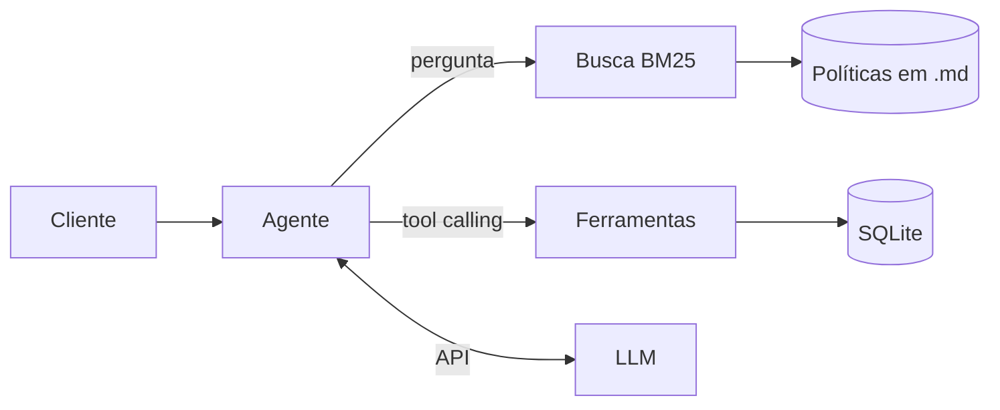

# Assistente de atendimento com IA para delivery

Projeto de portfólio: um assistente de atendimento ao cliente para um serviço de delivery **fictício**. Ele responde dúvidas com base nas políticas da empresa (RAG) e consulta pedidos por meio de ferramentas (*tool calling*), com foco em respostas confiáveis, segurança dos dados do cliente e qualidade mensurável.

> **Status: em desenvolvimento.** Veja o checklist abaixo para saber o que já está pronto.

## O que o projeto demonstra

- **RAG:** o assistente responde com base em documentos de políticas, em vez de inventar regras.
- **Tool calling:** o modelo decide quando consultar o banco de pedidos ou abrir um chamado, e o código executa a ação.
- **Segurança por design:** um cliente nunca acessa pedidos de outro, e essa verificação é feita no código, não no prompt.
- **Avaliação (planejada):** um conjunto de perguntas com resposta esperada para medir a qualidade e acompanhar melhorias.

## Status

- [x] Conexão com LLM (API gratuita compatível com o formato da OpenAI)
- [x] Banco SQLite com dados fictícios (clientes, restaurantes, pedidos, chamados)
- [x] Busca nas políticas com BM25
- [x] Ferramentas do agente (consultar pedido, listar pedidos, abrir chamado)
- [x] Agente (loop de tool calling com RAG)
- [x] Guardrails (escopo, recusas, "não sei")- [ ] API (FastAPI) e interface de chat
- [ ] Avaliação automática (dataset e relatório)
- [ ] Testes automatizados, Docker e CI

## Arquitetura



O agente, a API e a interface ainda estão em desenvolvimento. A busca, o banco e as ferramentas já funcionam de forma independente.

## Decisões técnicas

1. **BM25 em vez de embeddings.** Evita dependências nativas pesadas, roda em qualquer versão recente do Python e é fácil de depurar, porque dá para ver a pontuação de cada trecho. A busca está isolada na classe `Retriever`, então pode ser trocada por embeddings depois sem mexer no resto.
2. **O `cliente_id` vem da sessão, nunca do modelo.** Nenhuma ferramenta pede `cliente_id` como parâmetro, e o executor descarta qualquer `cliente_id` que o modelo tente enviar.
3. **Contas ficam no código.** O atraso em minutos é calculado pela ferramenta, porque modelos erram cálculos com datas.
4. **Mesma resposta para "pedido inexistente" e "pedido de outro cliente"**, para não revelar que o pedido existe.
5. **LLM via API compatível com OpenAI.** Trocar de provedor ou de modelo exige só mudar o `.env`.

## Estrutura

```
data/knowledge/          políticas fictícias (.md)
src/
├── config.py            configurações e variáveis de ambiente
├── hello_llm.py         teste de conexão com o LLM
├── database/            schema.sql, seed.py, repository.py
├── rag/                 retriever.py (busca BM25)
└── tools/               order_tools.py (ferramentas do agente)
.env.example             modelo das variáveis de ambiente
requirements.txt
```

## Como rodar

Requer Python 3.10 ou superior e uma chave gratuita do [Groq](https://console.groq.com/keys).

```powershell
git clone https://github.com/NicoleHSilva/assistente-delivery-ia.git
cd assistente-delivery-ia
python -m venv .venv
.venv\Scripts\activate          # Windows (PowerShell)
# source .venv/bin/activate     # macOS / Linux
pip install -r requirements.txt
```

Crie o arquivo `.env` a partir do modelo e preencha a chave:

```powershell
Copy-Item .env.example .env     # macOS / Linux: cp .env.example .env
```

```
LLM_API_KEY=sua_chave_aqui
LLM_MODEL=openai/gpt-oss-120b
LLM_BASE_URL=https://api.groq.com/openai/v1
```

O catálogo de modelos do Groq muda com frequência. Se o modelo não for encontrado, escolha outro na lista de modelos de texto do Groq e atualize `LLM_MODEL`.

## Testes manuais (por enquanto)

```powershell
python -m src.hello_llm            # testa a conexão com o LLM
python -m src.database.seed        # cria o banco com dados fictícios
python -m src.rag.retriever        # busca interativa nas políticas
python -m src.tools.order_tools    # exercita as ferramentas, incluindo casos de segurança
```

## Limitações conhecidas

- **A busca por palavras não entende sinônimos.** Em testes manuais com perguntas reais, o trecho correto sempre apareceu entre os 3 primeiros, mas nem sempre em 1º (por exemplo, "pedir" não casa com "solicitar" no texto da política). A avaliação automática vai medir isso e comparar melhorias.
- **O plano gratuito da API tem limites** e pode responder com erros temporários (429 ou 503). O tratamento com novas tentativas automáticas está nos próximos passos.
- **Os dados e as políticas são inventados.** Nenhum valor ou regra representa uma empresa real.
- **Dados "em andamento" envelhecem.** O banco fictício é gerado relativo ao horário em que o `seed` roda, então pedidos "a caminho" ficam cada vez mais atrasados com o tempo. A avaliação automática vai usar um relógio fixo.

## Próximos passos

1. Agente: loop de tool calling combinado com o RAG
2. Guardrails: recusar assuntos fora do escopo e responder "não encontrei na política" quando a busca não trouxer nada
3. API com FastAPI e interface de chat
4. Avaliação automática com 30 a 50 casos, incluindo armadilhas de segurança
5. Testes com pytest, Docker e CI no GitHub Actions

## Aviso

Projeto educacional, sem relação com nenhuma empresa real.

## Licença

Distribuído sob a licença MIT. Veja o arquivo [LICENSE](LICENSE).

## Autora

Nicole Henrique Silva, estudante de Análise e Desenvolvimento de Sistemas.